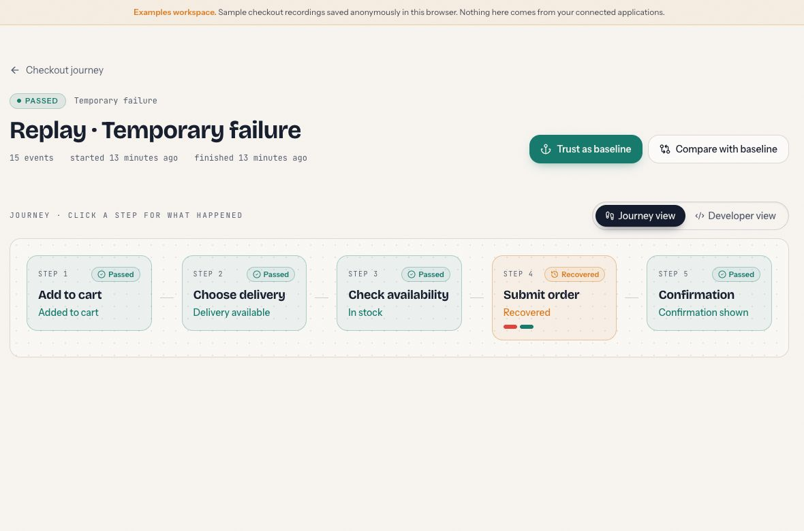
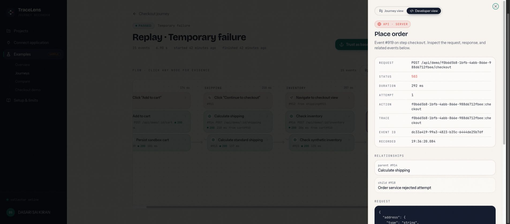
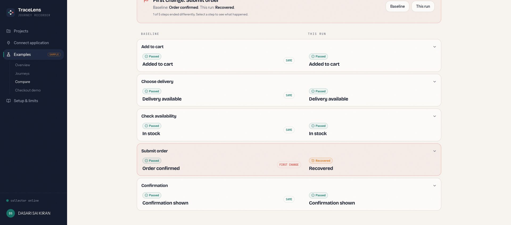
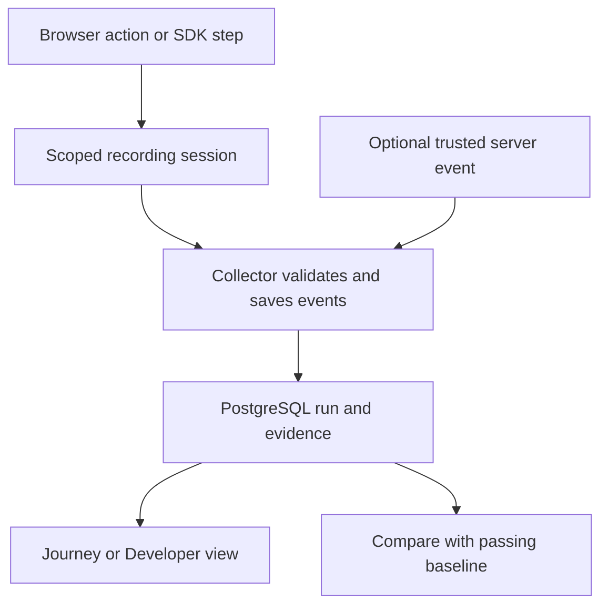

# TraceLens

**See what an application did, where a journey changed, and whether it recovered.**

[Try the public demo](https://trace-lens.replit.app/demo) · [View the Handshake project](https://app.joinhandshake.com/ai-showcase/projects/3741542) · [Integration and operations guide](docs/INTEGRATION-RUNBOOK.md)

TraceLens turns a user journey into an evidence-backed, live **How it works** diagram. A product manager can follow a few plain-language steps; an engineer can switch to Developer view to inspect correlated requests, status codes, timing, parent events, and trusted server events. Both views read the same saved run. Comparing a run against a chosen passing baseline highlights changed outcomes, attempts, timing, and missing steps.

## The problem it solves

When a workflow fails, reproducing it and matching a user's clicks to server activity takes time. Logs often reveal an error without showing the journey that led to it. TraceLens records a consented, scoped workflow and makes the sequence reviewable. The immediate productivity task is **explaining and comparing a workflow run** rather than manually stitching together screenshots, requests, and log lines.

## See the flows

| Flow | What to do | What appears |
| --- | --- | --- |
| Working checkout | In [the demo](https://trace-lens.replit.app/demo), select **Working path**, then run the checkout. | Cart, shipping and inventory, checkout, and confirmation complete. Save the passing run as a baseline. |
| Recovering checkout | Select **Transient 503** and replay. | The first order attempt gets a 503, a bounded retry succeeds, and the checkout is marked **Recovered**. The original failure remains visible. |
| Validation failure | Select **Missing address** and replay. | Checkout gets a 422 and the run fails. The failed step and its recorded evidence remain available. |
| Compare | Open a completed run, choose a trusted passing baseline, and use **Compare**. | The side-by-side view points to changed, failed, recovered, or unreached steps. |
| Developer evidence | Switch from **Journey** to **Developer** and select a step. | The same events reveal API paths, HTTP status, durations, attempts, and server instrumentation. |

The demo is an **example workspace**. Its notebook, inventory, shipping, and order are simulated business data, but clicking/replaying executes server operations, writes events to PostgreSQL, and exercises the retry and rollback behavior. It does not charge a card or create a real order. The public example is separate from signed-in users' projects.

### Screenshots

**Journey view — a recovered checkout retains the failed attempt:**



**Developer view — request and server evidence for the selected step:**



**Comparison — a passing baseline beside a changed run:**



## How it works



- **Frontend:** React, TypeScript, Vite and TanStack Query display live runs, step selection, the two synchronized views, comparison, projects, and setup.
- **API:** Express validates run/session ownership, accepts correlated browser and optional trusted server events, executes the example checkout, and serves exports.
- **Database:** PostgreSQL stores run events, actions, expected-step snapshots, sessions, baselines, project ownership, and server credentials. Migrations are additive.
- **Integration SDK:** A separate application can explicitly connect with user consent and a short-lived recording session, wrap its own `fetch` through `ctx.fetch`, and assert its real business outcome via `ctx.outcome`. TraceLens does not infer business success from HTTP 2xx alone.

The browser SDK records safe paths, method, status, and duration; it strips URL query/hash and does not capture request/response values by default. Optional schema metadata reports field presence/type with values redacted. An application can send correlated internal/outcome events from its server through a separate, scoped credential. An [independent HTTP fixture](fixtures/external-app/) demonstrates the SDK against an app on another origin; see the [integration guide](docs/INTEGRATION-RUNBOOK.md) for the setup and trust boundaries.

## Failure handling

| Failure | What TraceLens does |
| --- | --- |
| Temporary 503 in the demo | Records the failed request, retries once after a bounded delay, then marks the step Recovered if the next actual operation succeeds. |
| Missing required address | Records the 422 validation failure; the run does not claim an order was placed. |
| Database write fails during a demo operation | Rolls back the application operation and its evidence in one transaction, then shows a retryable error. |
| Collector delivery fails | SDK queues redacted events in tab session storage, retries with backoff, and deduplicates accepted event IDs on the server. A delivery warning is surfaced; an incomplete run is never used as a trusted baseline. |
| Recording is interrupted or expires | Preserves partial evidence and marks the run incomplete instead of reporting an unverified success. |

Unsent evidence can still be lost when a tab closes, storage is unavailable, or a session expires. Recovery does not imply guaranteed delivery.

## Run locally or on Replit

**Requirements:** Node.js 24, pnpm 10, PostgreSQL 16, and Clerk development keys. Replit provides managed workflows and PostgreSQL for the published setup. Copy [`.env.example`](.env.example) into your own local environment configuration or set equivalent Replit Secrets; never commit secrets.

```sh
pnpm install --frozen-lockfile
node scripts/src/migrate-real-projects.mjs
pnpm run typecheck
pnpm run build
```

Start the `artifacts/api-server: API Server` and `artifacts/tracelens: web` Replit workflows. The API needs `DATABASE_URL`, `CLERK_SECRET_KEY`, `CLERK_PUBLISHABLE_KEY`, and `PORT`; the frontend build needs `VITE_CLERK_PUBLISHABLE_KEY`. Replit's managed routing serves the frontend at `/` and API at `/api`; for another host, configure equivalent routing and Clerk domains. `GET /api/healthz` checks liveness and `GET /api/readyz` checks database/auth configuration. The [operations guide](docs/INTEGRATION-RUNBOOK.md) has integration steps, session lifetimes, retention, and deployment limitations.

For a separate local fixture:

```sh
node fixtures/external-app/server.mjs
# Visit http://localhost:4321 after allowing that exact origin in a test project.
```

## Verification and current scope

```sh
node --experimental-strip-types --test scripts/src/journey-projection.test.mjs scripts/src/sdk-exception.test.mjs scripts/src/setup-guidance.test.mjs
node --experimental-strip-types --test scripts/src/real-integration.test.mjs
pnpm --filter @workspace/scripts exec tsx --test src/retention.test.mjs
```

The integration test requires a running API and fixture. The published Replit build and focused projection/SDK tests were checked; the separate-origin fixture was exercised with the distributed SDK and persisted collector events in a native browser. See the [verification notes](docs/INTEGRATION-RUNBOOK.md#verification-commands-and-evidence) for what passed and what remains unverified. A production deployment for arbitrary third-party apps still needs a real developer-hosted installation, signed-in end-to-end verification, capacity testing, and operational backup/incident procedures.

## Repository map

| Path | Purpose |
| --- | --- |
| [`artifacts/tracelens`](artifacts/tracelens) | Web UI and Journey/Developer projections |
| [`artifacts/api-server`](artifacts/api-server) | API, collector, demo operations, session controls |
| [`lib/db`](lib/db) | PostgreSQL schema and connection |
| [`lib/api-spec`](lib/api-spec) | API contract and generated client inputs |
| [`fixtures/external-app`](fixtures/external-app) | Independent app integration fixture |
| [`scripts/src`](scripts/src) | Migrations and regression/integration checks |

## Next

Install the SDK in a developer-owned application and validate its signed-in end-to-end workflow; then add production monitoring, retention/erasure controls, and disaster recovery. The built-in checkout and separate fixture already demonstrate recording, failed versus recovered runs, comparison, and cross-origin ingestion, while those production integrations remain future work.
